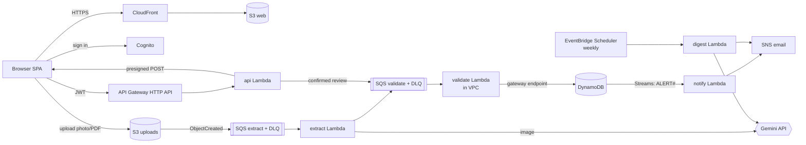

# SupplyRadar

**Catch supplier price increases the day the invoice arrives.**

A café or shop owner photographs a supplier invoice. Gemini reads it into structured JSON,
code checks every number, and the price history in DynamoDB is updated. If a product now costs
more than last time (default threshold +5 %), the owner gets an email, including a cheaper supplier
when one exists. Every Monday a plain-language digest summarises where they overpaid.

Final project for *Cloud-Native AI Application Deployment* (IITU). Fully serverless on AWS,
built with Terraform, designed to run at **$0/month** at demo load.


## What the app does

| Area | For | What it does |
|---|---|---|
| Invoices, products, alerts | business | Photo of an invoice -> Gemini -> checked numbers -> price history and alerts |
| Business templates | business | After sign-up the owner picks cafe, restaurant, shop, bakery or other: sets the alert threshold and hints |
| «Вернём переплату» | business | Monthly overpay report (30 days, previous period, last six months), what Pro would pay back, Excel export |
| Claims to suppliers | business | One click from an alert or a contract violation: ready text with numbers and the invoice, status draft -> sent -> resolved with the refunded amount |
| Contract prices | business | Price from the supplier contract plus tolerance; invoices above it are flagged and can be turned into a claim (3 on free, unlimited on Pro) |
| Network of points | business | «Сеть» plan: up to 9 points, an invoice is assigned to a point on upload, per-point spend and overpay comparison |
| First run | business | Sample data on first sign-in (can be switched off and removed any time), «Начало работы» card, empty states with the next step |
| Suppliers and orders | both | A supplier signs up as «Я поставщик», keeps a catalog (CSV price list import) and gets orders; a business compares catalog prices with its own, then orders |
| Recipes | business | Cost and margin of a dish from the latest invoice prices; 3 recipes on the free plan |
| Plans and AI assistant | business, supplier | Free / Pro / «Сеть» / supplier Pro (demo payment, nothing is charged). Pro and «Сеть» unlock the Gemini assistant that answers from the owner's own data (30 questions a day) |
| Admin panel | admin | Service-wide counts: accounts, suppliers, orders, plans, invoice statuses |
| Telegram bot | | Not built yet: needs a bot token from @BotFather |

## Architecture



13 AWS services: S3, CloudFront, Cognito, API Gateway, Lambda (5 functions), SQS (2 queues + 2 DLQs),
DynamoDB (+ Streams), SNS, EventBridge Scheduler, VPC (private subnets, gateway endpoints, no NAT),
SSM Parameter Store, CloudWatch (+ Budgets), IAM (one role per function, GitHub OIDC).

Details: [docs/architecture.md](docs/architecture.md).

## Repository layout

```
terraform/
  main.tf variables.tf outputs.tf   root stack (one per environment via tfvars)
  iam.tf versions.tf
  bootstrap/                        remote state bucket (run once per account)
  envs/                             dev.tfvars, prod.tfvars, *.backend.hcl.example
  modules/                          13 modules: network storage database queue auth api
                                    frontend lambda_function monitoring notifications ci waf kms
  tests/plan.tftest.hcl             offline plan test with a mocked AWS provider
src/
  backend/                          Python 3.13 Lambda code (stdlib + boto3 only)
    api.py extract.py validate.py notify.py digest.py
    supplyradar/                    shared: checks, pricing, products, gemini, db,
                                    market (suppliers, orders, plans, assistant, savings, recipes),
                                    growth (points, contract prices, claims, sample data)
  frontend/                         HTML + JS single-page app (Russian UI), no build step
scripts/make_sample_invoices.py     synthetic invoices + ground truth
samples/                            eval/ (12 invoices) and demo/ (4-step live demo)
tests/unit/                         pytest (58 tests)
tests/eval/run_eval.py              Gemini field-accuracy test (Week 1 checkpoint, target >= 80 %)
tests/e2e/                          local fake backend, Playwright browser test, axe accessibility test (CI job «ui»)
tests/load/load_test.py             stepped load test with a chart (local or against AWS)
scripts/cost_model.py               monthly cost estimate for 100 and 10 000 users
scripts/smoke_test.py               post-deploy check: HTTPS, security headers, API protected
docs/                               architecture, setup guide, security, CI/CD, monitoring, load test,
                                    cost, troubleshooting, demo script, interview guide
.github/workflows/ci.yml            tests, terraform validate/test, UI tests, Checkov scan, plan via OIDC
.github/workflows/deploy.yml        terraform apply via OIDC (off until the owner sets it up)
```

## Quick start

Full step-by-step instructions: [docs/setup-guide.md](docs/setup-guide.md).

```bash
# 0. tools: Terraform >= 1.10, AWS CLI v2, Python 3.12+
python3 -m pip install -r requirements-dev.txt
make test tf-test                     # everything offline, no AWS needed

# 1. state bucket (once)
cd terraform/bootstrap && terraform init && terraform apply && cd ../..
cp terraform/envs/dev.backend.hcl.example terraform/envs/dev.backend.hcl   # put the bucket name

# 2. Gemini key -> SSM (never in Git or Terraform state)
aws ssm put-parameter --name /supplyradar/dev/gemini-api-key --type SecureString --value "$GEMINI_API_KEY"

# 3. deploy (your alarm email goes to a git-ignored file first)
echo 'alarm_email = "you@your-mail.com"' > terraform/owner.auto.tfvars
make init plan apply
make outputs                          # app_url = https://xxxx.cloudfront.net
```

Then open `app_url`, sign up, upload `samples/demo/1-…png`, `2-…`, `3-…` in order and watch the
price alert arrive. Tear down after the defence with `make destroy`.

## Operations and security

| Topic | Summary | Details |
|---|---|---|
| Environments | dev and prod from the same code, separate state and names | [setup guide](docs/setup-guide.md#10-production-environment) |
| CI/CD | tests, security scan and `terraform plan` on pull requests; deploy through a GitHub OIDC role, no stored keys, off by default | [docs/cicd.md](docs/cicd.md) |
| Security | HTTPS + CSP, API rate limits, least-privilege IAM, optional WAF and KMS key | [docs/security.md](docs/security.md) |
| Monitoring | one dashboard, 10 alarms, X-Ray traces, saved log queries | [docs/monitoring.md](docs/monitoring.md) |
| Backups | DynamoDB point-in-time recovery, S3 versioning and lifecycle | [docs/monitoring.md](docs/monitoring.md#backups-and-restore) |
| Load and cost | load test with a chart; about $1 a month of AWS at 100 businesses, about $180 at 10 000 | [docs/load-test.md](docs/load-test.md), [docs/cost-analysis.md](docs/cost-analysis.md) |

## Local development without AWS

```bash
make local                            # http://localhost:8765, real API code + fake AWS
```

Uploading any file from `samples/` behaves like the real pipeline (its ground truth replaces Gemini).

## AI accuracy (Week 1 checkpoint)

Measured 2026-10-20 with `gemini-3.5-flash-lite` on the 12 synthetic invoices in `samples/eval`
(`tests/eval/run_eval.py`):

| Metric | Result | Target |
|---|---|---|
| Field accuracy (BIN, number, date, total, every line's name, qty, price, total, product match) | **253 / 255 = 99.2 %** | ≥ 80 % |
| Invoices where the 5 checks gave the right verdict | **12 / 12** | |
| Demo set (`samples/demo`, incl. the invoice with an arithmetic error) | 74 / 75 fields, 4 / 4 verdicts | |
| Time per invoice | 1.8–7.3 s (median ≈ 2.3 s) | ~10 s end to end |

The only misses were a product name normalised as «яйцо с1 10 шт» instead of «яйца с1 10 шт».
Cross-supplier matching worked: «СЛИВКИ 33% 0,5Л» and «Сливки 33% 0,5 л» became one product.

## Testing

| What | Command | Needs |
|---|---|---|
| Unit tests (checks, pricing, handlers) | `make test` | Python |
| Terraform fmt / validate / offline plan | `make tf-test` | Terraform |
| Security scan of the Terraform code | `make security` | `pip install checkov==3.4.5` |
| Load test (local stand-in, or AWS) | `make load-test` | Python (+ matplotlib for the chart) |
| Deployed site health | `make smoke` | a deployed environment |
| AI extraction accuracy | `GEMINI_API_KEY=… make eval` | Gemini key |
| Browser test of the web app | `make local` then `node tests/e2e/ui.spec.mjs` | Node + Playwright |
| Accessibility (WCAG 2.2 AA, axe) | after the browser test: `node tests/e2e/a11y.mjs` | + `axe-core` |
