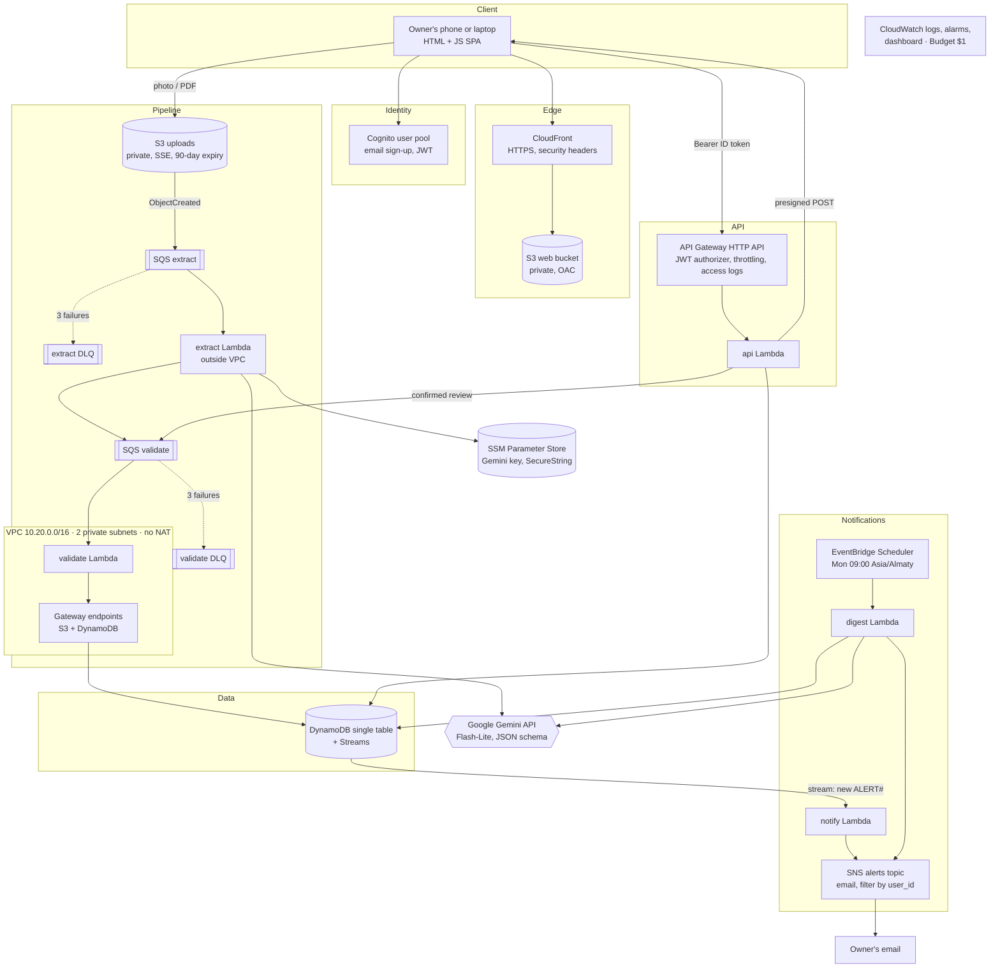
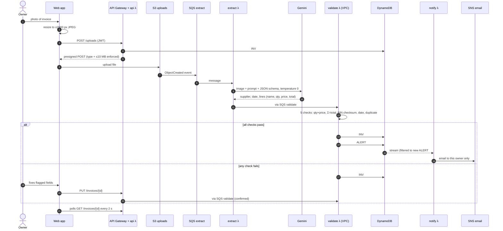

# Architecture

SupplyRadar is an event-driven serverless application on AWS (region `eu-central-1`).
AI does one job, reading the invoice; plain code checks every number before anything is trusted.

## System diagram

## Services and their single job

| Service | Job | Free allowance used |
|---|---|---|
| S3 | Web app files; invoice uploads | 5 GB (12 months) / credits |
| CloudFront | Public HTTPS URL, caching, security headers | 1 TB + 10 M requests / month (always free) |
| Cognito | Sign-up, sign-in, JWT | 10 000 MAU (always free) |
| API Gateway (HTTP API) | REST API, JWT auth, throttling | 1 M calls / month (12 months) |
| Lambda × 5 | api, extract, validate, notify, digest | 1 M requests + 400 000 GB-s (always free) |
| SQS × 4 | Buffer between steps, retries, dead-letter queues | 1 M requests (always free) |
| DynamoDB + Streams | Invoices, product catalog, price history, alerts | 25 GB, 25 RCU/WCU (always free) |
| SNS | Alert and digest emails | 1 000 emails (always free) |
| EventBridge Scheduler | Weekly digest trigger | 14 M invocations (always free) |
| VPC | Isolates the function that writes business data | free (no NAT) |
| SSM Parameter Store | Gemini API key as SecureString | standard parameters free |
| CloudWatch + Budgets | Logs (7 days), 7 alarms, dashboard, $1 budget | 10 alarms, 5 GB logs, 3 dashboards |
| IAM | One least-privilege role per function, GitHub OIDC | free |

Not counted as AWS services: the Gemini API (external AI) and Terraform (tooling).

## Request flow: one invoice from photo to alert

Target latency: result on screen about 10 seconds after upload (Gemini call dominates).

## Data model (single DynamoDB table)

Partition key `PK = USER#<cognito sub>` keeps every owner's data separate; queries never cross users.

| SK pattern | Item | Written by |
|---|---|---|
| `SETTINGS` | alert threshold, email, SNS subscription ARN | api |
| `INV#<time-ordered id>` | status, supplier, BIN, number, date, total, lines, issues | api, extract, validate |
| `DUP#<supplier>#<number>` | first invoice with that number (duplicate check) | validate |
| `ALIAS#<printed name>` | product key a printed name maps to | validate |
| `PROD#<product key>` | latest price per supplier (for comparison) | validate |
| `PRICE#<product>#<date>#<invoice>#<n>` | one price observation (history chart) | validate |
| `ALERT#<time>#<invoice>#<product>` | price increase ≥ threshold, cheaper supplier | validate |

**Product matching.** Gemini returns a `canonical_name` for each line (`"МОЛОКО 3,2 1Л"` and
`"Молоко 3,2% 1 л"` both become `молоко 3.2% 1 л`). Code turns it into a key. The first key seen for a
printed name is cached in `ALIAS#`, so a known product keeps its key even if the model words it differently later.

**Idempotency.** SQS delivers at least once. Invoices already `checked` are skipped; price history keys
are deterministic; alerts are written with `attribute_not_exists`, so a duplicate delivery cannot send a second email.

## Why AI plus code

| | Rules / templates | AI alone | **AI + code (SupplyRadar)** |
|---|---|---|---|
| New supplier layout | new template each time | works | works |
| Photo at an angle, stamps | breaks | works | works |
| Misread digit | n/a | silently wrong | caught by arithmetic check |
| Memory of past prices | n/a | none | DynamoDB history |
| Alerts | n/a | none | Streams → SNS |

Gemini is called with `responseSchema` (structured output) and `temperature 0`. The prompt tells it to
copy numbers as printed and never fix them, so the checks can find errors on the document itself.

## Security considerations

- **Identity:** Cognito email sign-up with verification; API Gateway rejects any request without a valid
  ID token for this user pool and client (JWT authorizer on all 9 routes).
- **Tenant isolation:** user id comes only from the verified token (`sub` claim), never from the request body;
  all keys are under `USER#`; SNS subscriptions carry a filter policy on `user_id`.
- **Least privilege IAM:** one role per function, scoped to exact table, bucket prefix (`uploads/*`), queue,
  topic and parameter ARNs (`terraform/iam.tf`). The GitHub Actions role is read-only and can only take the state lock.
- **Secrets:** the Gemini key is an SSM SecureString created with the AWS CLI; Terraform only knows its name,
  so the key never appears in Git, plans or state.
- **Network:** the validate function runs in private subnets with no internet route; its security group allows
  only HTTPS to the S3 and DynamoDB gateway endpoints. The default security group is emptied.
  The extract function stays outside the VPC on purpose: calling Gemini from inside would need a NAT gateway (~$32/month).
- **Data protection:** all buckets private with Block Public Access; web bucket readable only by this CloudFront
  distribution (OAC); uploads bucket denies non-TLS requests; encryption at rest on S3, DynamoDB, SQS, SNS;
  originals expire after 90 days.
- **Input validation:** content type and size enforced by the presigned POST policy (JPEG/PNG/WEBP/PDF, ≤ 10 MB);
  API validates every body; model output passes JSON schema and arithmetic checks before it is stored as trusted.
- **Abuse and cost:** API throttling (10 rps, burst 20); extract concurrency capped at 2; $1 budget alert.
- **AI data:** the free Gemini tier may use inputs to improve Google's models, so only synthetic invoices
  (`samples/`) are used for the demo. A real deployment would switch to the paid tier.

## Scalability and reliability

- Lambda, SQS and DynamoDB scale automatically; the practical limit is the Gemini quota, which is why
  extract concurrency is capped and 429 responses are retried with growing delays (60 s, 120 s, ×3 on rate limit).
- After 3 failed attempts a message moves to its DLQ, the invoice is marked `failed` (the owner can type it in),
  and a CloudWatch alarm emails the operator. Messages can be replayed with SQS redrive.
- DynamoDB Streams only wakes the notify function for new `ALERT#` items (event filter), so other writes cost nothing.
- Two subnets in two availability zones for the VPC function.
- Moving beyond the free tier: switch DynamoDB to on-demand, raise extract concurrency with a paid Gemini tier,
  add a custom domain + ACM certificate on CloudFront.
