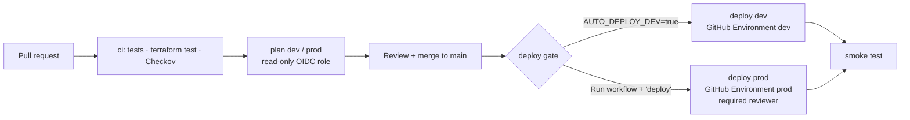

# CI/CD

Two workflows in `.github/workflows/`:

| Workflow | Runs on | What it does | Touches AWS? |
|---|---|---|---|
| `ci.yml` | every pull request and push to `main` | unit tests, load-test self-check, `terraform fmt / validate / test`, Checkov security scan | no |
| `ci.yml`, job *Terraform plan* | pull requests, once the plan role exists | read-only `terraform plan` for dev (and prod), summary on the run page | reads only |
| `deploy.yml` | "Run workflow" button; push to `main` only if switched on | checks → plan → data-loss guard → `terraform apply` → CDN refresh → smoke test | **yes** |



## Nothing deploys by itself

Out of the box the deploy workflow starts, prints *"no deploy role is configured"* and stops.
A deploy from GitHub happens only after **all** of these deliberate steps by the owner:

1. the deploy role exists in AWS (created by the owner's own `terraform apply` with `enable_github_deploy = true`);
2. its ARN is saved in the repository variable `AWS_DEPLOY_ROLE_ARN` (dev) or `AWS_DEPLOY_ROLE_ARN_PROD`;
3. the run is on the `main` branch;
4. either the owner pressed **Run workflow** and typed `deploy`, or, for dev only, the repository
   variable `AUTO_DEPLOY_DEV` is `true` (deploy after every merge that touches `terraform/` or `src/`).

Production is never deployed automatically. To switch everything off again, delete the variable
`AWS_DEPLOY_ROLE_ARN*` (or set `AUTO_DEPLOY_DEV` to anything but `true`).

## No stored AWS keys

GitHub proves its identity to AWS with a short-lived OpenID Connect token; AWS answers with temporary
credentials for one role (1 hour). There is no access key in GitHub to leak or rotate.

| Role | Created when | Who may assume it | Can do |
|---|---|---|---|
| `supplyradar-<env>-github-plan` | `github_repository` is set | pull requests and `main` of this repository | read configuration for `terraform plan`; denied reading data and secrets |
| `supplyradar-<env>-github-deploy` | also `enable_github_deploy = true` | only jobs in the GitHub Environment `<env>` | `terraform apply` for this project; cannot change its own access |

Details and the remaining risks: [security.md](security.md#iam-least-privilege-review).

## Setup (once, about 15 minutes)

**1. Create the roles for dev** from your own machine:

```bash
# terraform/envs/dev.tfvars: uncomment and fill
#   github_repository    = "<owner>/supplyradar"
#   state_bucket         = "supplyradar-tfstate-<account id>"
#   enable_github_deploy = true        # leave out if you only want plans
make plan apply
terraform -chdir=terraform output github_plan_role_arn github_deploy_role_arn
```

**2. Save the settings in GitHub** → repository → Settings → Secrets and variables → Actions → **Variables**:

| Variable | Value |
|---|---|
| `AWS_PLAN_ROLE_ARN` | output `github_plan_role_arn` |
| `TF_STATE_BUCKET` | `supplyradar-tfstate-<account id>` |
| `ALARM_EMAIL` | the same address you use for `alarm_email` |
| `AWS_DEPLOY_ROLE_ARN` | output `github_deploy_role_arn` (only if you want deploys from GitHub) |
| `AUTO_DEPLOY_DEV` | `true` (only if dev should deploy after each merge to `main`) |

These are variables, not secrets: a role ARN is useless without GitHub's own token.

**3. Create the GitHub Environments** → Settings → Environments → `dev` and `prod`.
For `prod` add **Required reviewers** (yourself) and limit **Deployment branches** to `main`.
The AWS deploy role trusts only jobs that run in the Environment with its name, so this approval
cannot be skipped from a workflow file.

**4. Production** (after `make init plan apply ENV=prod` works locally, see the setup guide):

```bash
# terraform/envs/prod.tfvars: uncomment
#   github_repository           = "<owner>/supplyradar"
#   state_bucket                = "supplyradar-tfstate-<account id>"
#   enable_github_deploy        = true
#   create_github_oidc_provider = false   # dev already created the account's provider
make init plan apply ENV=prod
```

Save the outputs as `AWS_PLAN_ROLE_ARN_PROD` and `AWS_DEPLOY_ROLE_ARN_PROD`.

## What a deploy run does

1. **Gate**: decides whether deployment is switched on (see above) and writes the reason to the run summary.
2. **Checks**: the whole `ci.yml` again; a red check stops the deploy.
3. **Plan**: `terraform plan -out=tfplan` against the environment's own state.
4. **Data-loss guard**: the run fails if the plan deletes or replaces the DynamoDB table, the user
   pool, a bucket or the KMS key. Such changes are made by the owner, by hand, on purpose.
5. **Apply** of exactly the saved plan.
6. **CDN refresh**: CloudFront invalidation so browsers get the new web app.
7. **Smoke test** (`scripts/smoke_test.py`): site answers 200 over HTTPS, HTTP redirects, security
   headers are present, `config.js` points to the API, the API refuses requests without a token.

Runs for the same environment queue up; a running apply is never cancelled.

## Rolling back

- **Code or infrastructure**: revert the commit on `main` (GitHub → the merged PR → *Revert*) and deploy
  again. Terraform brings AWS back to the previous description.
- **Web app only**: the web bucket keeps old versions for 30 days (`web_versioning`), so a single file
  can be restored in the S3 console → *Show versions*.
- **Data**: DynamoDB point-in-time recovery, see [monitoring.md](monitoring.md#backups-and-restore).

## Local equivalents

| CI step | Local command |
|---|---|
| Python tests | `make test` |
| Terraform checks | `make tf-test` |
| Security scan | `pip install checkov==3.4.5 && make security` |
| Plan / apply | `make plan apply ENV=dev` |
| Smoke test | `make smoke` |
