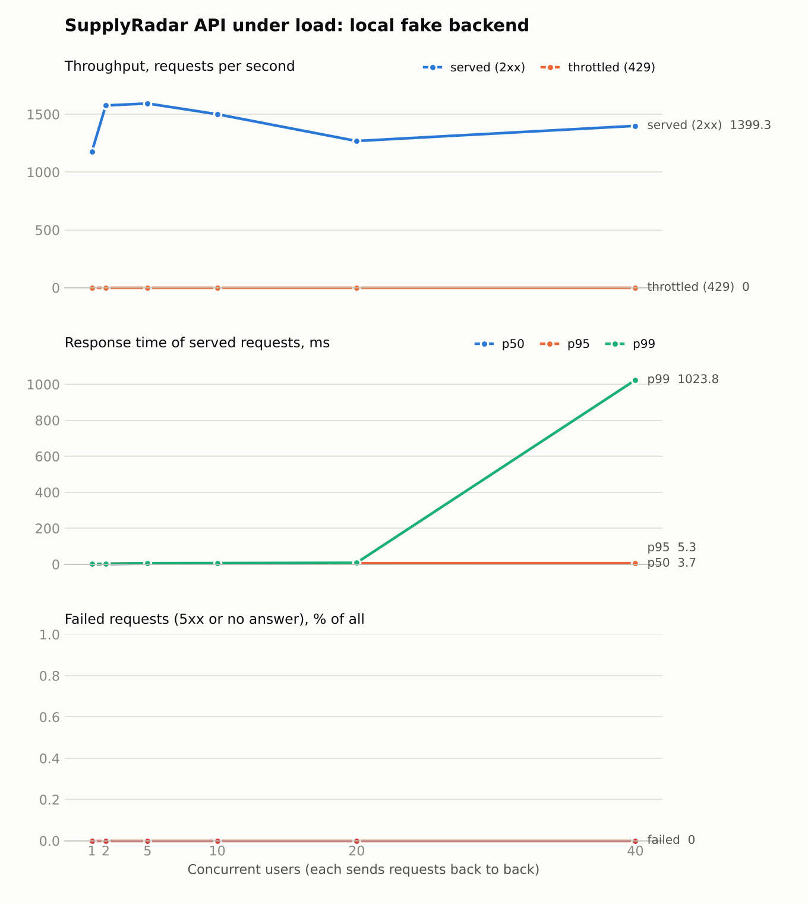

# Load test

`tests/load/load_test.py` raises the number of concurrent users step by step and measures, for every
step, served requests per second, response time (p50 / p95 / p99), throttled requests (HTTP 429) and
failures (5xx or no answer). It writes `results.csv`, `summary.md` and `chart.png`.

The test is **read-only**: it calls `GET /invoices`, `/products`, `/alerts`, `/settings` and `/savings`
with one signed-in account. It never uploads, so it does not call Gemini and writes nothing.

## Status of the numbers

| Run | Status |
|---|---|
| Local stand-in (`--local`) | done, results below. It proves the tool and the API code hold up; it says nothing about AWS speed. |
| Deployed dev environment | **not run yet**: it needs the owner's account password, and no deployment was allowed while this was written. One command, about 3 minutes, see below. |

## Run it against AWS

```bash
pip install -r requirements-dev.txt
export SR_PASSWORD='the password of your SupplyRadar account'
python3 tests/load/load_test.py \
  --api-url   "$(terraform -chdir=terraform output -raw api_url)" \
  --client-id "$(terraform -chdir=terraform output -raw user_pool_client_id)" \
  --email     you@your-mail.com
```

Default stages: 1, 2, 5, 10, 20, 40 users, 20 seconds each. Cost of one run: a few tens of thousands of API
calls, most of them rejected by the throttle before they reach Lambda: inside the free tier, a few cents otherwise. Put the resulting
`load-results/chart.png` on the slide, and keep the CloudWatch dashboard open during the run:
the API, Lambda and DynamoDB widgets show the same load from the inside.

## What to expect on AWS, and why

The limits are set in Terraform, so the shape of the chart is predictable. These are expectations
derived from the configuration, not measurements; replace them with your chart after the run.

| Stage | Expected | Reason |
|---|---|---|
| 1–5 users | every request served, p50 around 50–150 ms from Kazakhstan | one warm api function per concurrent request; most of the time is network distance to Frankfurt |
| 10–20 users | served throughput levels off near **10 req/s**, the rest get `429` | API Gateway throttle `api_throttle_rate = 10` (burst 20); this is the limit working, not a failure |
| 40 users | still ≈ 10 req/s served, most requests `429`, **0 % failed** | throttled requests are rejected at the edge of the API and never reach Lambda or DynamoDB |
| first request of a stage | a few hundred ms slower | Lambda cold start (arm64, Python, small package) |

What would limit the system if the throttle were raised:

| Limit | Value now | First symptom | Change |
|---|---|---|---|
| API throttle | 10 req/s, burst 20 | 429 | `api_throttle_rate` |
| DynamoDB provisioned capacity | 5 reads + 5 writes per second (burst credit for 5 minutes) | read/write throttle events on the dashboard, slower API | `table_billing_mode = "PAY_PER_REQUEST"` |
| Lambda concurrency | account limit (can be as low as 10 in a new account, 1 000 after a quota request) | `lambda-throttles` alarm | Service Quotas request |
| Gemini quota | free tier, 2 invoices at a time | queue backlog alarm; invoices wait, nothing is lost | paid tier + higher `maximum_concurrency` |

So for 100 businesses (about 4 requests per minute each at peak) the current settings are enough;
for 10 000 the three changes in the right column are needed. Costs for both: [cost-analysis.md](cost-analysis.md).

## Local result (tool self-check)

`python3 tests/load/load_test.py --local` starts `tests/e2e/fake_backend.py` (the real API handler
code on an in-memory table, one Python process) and loads it. Run of 2026-11-15, 6 s per stage:



| Users | Served req/s | p50 ms | p95 ms | p99 ms | Failed % |
|---:|---:|---:|---:|---:|---:|
| 1 | 1 064 | 0.9 | 1.2 | 1.5 | 0 |
| 5 | 1 546 | 3.2 | 4.3 | 5.3 | 0 |
| 10 | 1 406 | 3.9 | 5.4 | 7.2 | 0 |
| 20 | 1 369 | 3.8 | 5.3 | 7.8 | 0 |
| 40 | 1 279 | 3.6 | 5.1 | 1 015 | 0 |

Reading it: the API code itself answers in 1–5 ms and never failed in about 55 000 requests.
Throughput stops growing after 2 users because the stand-in handles one request at a time; the
p99 jump at 40 users is requests waiting for a connection on that single process. None of this
is an AWS number: on AWS every concurrent request gets its own Lambda instance.

## Options

| Option | Default | Meaning |
|---|---|---|
| `--stages 1,2,5,10,20,40` | | concurrent users per stage |
| `--stage-seconds 20` | | length of each stage |
| `--pause 3` | | rest between stages (lets the throttle bucket refill) |
| `--token <id token>` | | use a token instead of `--email` + `SR_PASSWORD` |
| `--out load-results` | | output folder |
| `--max-users 100` | | safety limit for one stage |
